# finapp

**An enterprise fintech reference platform, built to show how serious financial infrastructure is engineered.**

finapp covers digital banking, payments, merchants, settlement and reconciliation, FX and cross-border, credit, lending,
buy-now-pay-later, risk and AML, and accounting, all on one double-entry ledger. It is a Java 21 / Spring Boot modular
monolith on PostgreSQL. It is designed to run as many concurrent instances, and the build, not convention, enforces its
financial rules.

| Read this if you are… | Go to |
|---|---|
| 🛠️ an engineer, architect or reviewer | **[1. Technical details](#1-technical-details)** |
| 🙂 anyone else: a manager, a stakeholder, a curious reader | **[2. For non-technical readers](#2-for-non-technical-readers)** |

The canonical record of where the project is lives in [`docs/project/CURRENT_STATE.md`](docs/project/CURRENT_STATE.md).
Every number below was counted from the repository on 2026-11-21. The diagrams are [Mermaid](https://mermaid.js.org/),
which GitHub renders in place.

---

## 1. Technical details

### 1.1 At a glance

| | |
|---|---|
| 🏗️ **Shape** | One deployable modular monolith, `finapp-app`, run as **N ≥ 3 replicas**; a migration Job, `finapp-migrator`; and a static Operator Console, `finapp-console`, on the operator edge |
| 🧩 **Modules** | **25 Gradle modules**: 22 domain or platform modules, the pure `creditmath`, the `migrator` and the `app` |
| 🗄️ **Schema** | **388 forward-only Flyway migrations** across **21 schema-owning modules**, one PostgreSQL schema per module |
| 🌐 **API** | **560 published paths, 606 operations** (458 on the operator surface) and 871 schemas, in [`docs/api/openapi.json`](docs/api/openapi.json): generated from the running application and diffed on every build |
| 📐 **Decisions** | **150 ADRs** in [`docs/adr/`](docs/adr/README.md): 148 `Accepted`, 2 `Proposed` |
| 🔒 **Invariants** | **171 financial and platform invariants** (`INV-*`) in [`FINANCIAL_INVARIANTS.md`](docs/domain/FINANCIAL_INVARIANTS.md) |
| 🧾 **Audit and errors** | **469 auditable actions** ([`AUDITABLE_ACTIONS.md`](docs/architecture/AUDITABLE_ACTIONS.md)) and **399 error codes** ([`ERROR_CONTRACT.md`](docs/architecture/ERROR_CONTRACT.md)); guard tests reconcile both with the code |
| 💻 **Code** | 3,153 production Java files (~449k lines); 1,960 test files and 50 test fixtures; 12,513 test methods |
| 📦 **History** | 2,329 commits, 2026-08-31 to 2026-11-21 |

### 1.2 Where the project is

**Phases 0 to 16 are `COMPLETE`. Phase 17, the backend for the Operator Console, is in progress: 50 of 52 items done.**

```
Programme   ████████████████████████████████████████░░  17 of 18 phases complete (0-16)
Phase 17    ███████████████████████████████████████░░░  50 of 52 items: the end-to-end battery and the exit review open
```

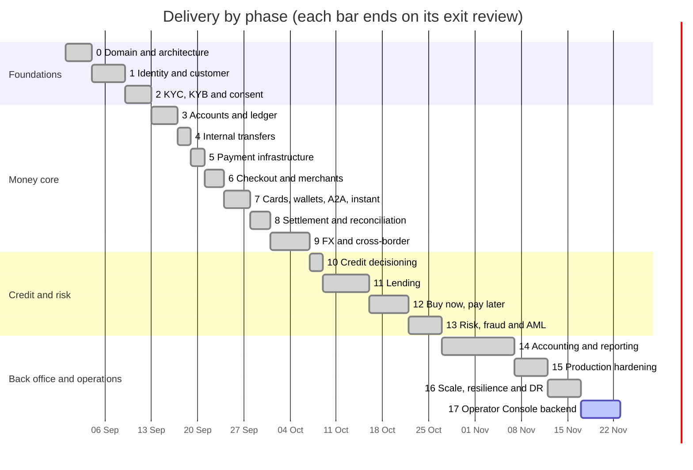

| # | Phase | What it delivered |
|---|---|---|
| 0 | Domain and Architecture Foundation | The boundary-enforced modular monolith; money, idempotency, outbox, audit and correlation before any business capability |
| 1 | Identity and Customer Foundation | Party, customer and identity; authentication, server-side sessions, MFA, authorisation, audit |
| 2 | KYC/KYB and Consent | The verification lifecycle, screening adapters, evidence kept verbatim, an append-only consent history |
| 3 | Accounts and Financial Ledger | Chart of accounts, double-entry journal, explainable balances, holds, reversals, four-eyes adjustments |
| 4 | Internal Transfers | The first end-to-end money movement, conserved under ten concurrent instances |
| 5 | Payment Infrastructure | Payment intents and attempts, provider adapters, an honest `UNKNOWN`, refunds, authenticated webhooks |
| 6 | Checkout and Merchant Platform | Merchant onboarding behind KYB, checkout, versioned fee schedules, merchant payouts, tenancy |
| 7 | Cards, Wallets, A2A and Instant Payments | Three rails behind one abstraction; disputes and chargebacks posted exactly once |
| 8 | Settlement and Reconciliation | Settlement ingestion, matching, breaks, suspense and investigation |
| 9 | FX and Cross-Border Payments | Quotes, rate locks, conversion, FX cover, corridors and the cross-border workflow |
| 10 | Credit Decisioning | Credit profiles, bureau adapters, versioned policy and scorecards, explainable decisions |
| 11 | Lending | Applications, offers, disbursement, schedules, accrual, repayment, credit lines, delinquency, lending capital |
| 12 | Buy Now, Pay Later | Pay-in-N at checkout, merchants paid upfront net of fee, refunds latest-instalment-first |
| 13 | Risk, Fraud and AML | Signals, rules, decisions, cases and ongoing monitoring |
| 14 | Accounting and Financial Reporting | The GL as a versioned mapping over the journal, periods with a posting cutoff, a four-eyes close, reports |
| 15 | Production Hardening | Two reproducible, signed images; Kubernetes manifests; a segmented edge; Terraform verified with mock providers; SLOs and runbooks |
| 16 | Scale, Resilience and Disaster Recovery | Load characterisation (k6, Toxiproxy), degradation modes, backup and restore, the DR stance |
| 17 | Operator Console *(in progress)* | The operator endpoints, edge and admission behind the console in the `finapp-admin-panel` repository |

**A phase is complete when a review says so, not when its tasks are.** Each phase closes on an exit review against
twelve universal criteria, the financial supplement F1-F8 and the phase's own criteria, and a transition audit opens the
next. Several reviews failed their gate and sent the phase back
([`docs/project/reviews/`](docs/project/reviews/)).

> **Not done yet:**
> - **Never deployed.** Nothing has run in a real environment. The images, manifests and Terraform are built, checked
>   in CI and rehearsed on `kind`; there is no cloud account, and provider connectivity is simulated.
> - **Phase 17's verification is partial, by the owner's choice.** Its later tasks ran on the unit and slice tiers only,
>   and five (`P17-TSK-123` to `-126`, `-040`) merged on no tests at all. The database, architecture and end-to-end
>   tiers are recorded as owed, as are five known-red unit cases from `P17-TSK-124`.
> - Open items, debt and postponed issues: `CURRENT_STATE.md` and [`POSTPONED_ISSUES.md`](docs/project/POSTPONED_ISSUES.md).

### 1.3 Architecture

#### The runtime shape

A **modular monolith** (ADR-0001): one deployable whose modules are bounded contexts with their own PostgreSQL schemas,
published ports and enforced boundaries. It is one *deployable*, never one *process*. It always runs as N concurrent
replicas, and **nothing about correctness rests on a single JVM, a local lock, local memory or a single scheduler**
(ADR-0014, [`DISTRIBUTED_EXECUTION.md`](docs/architecture/DISTRIBUTED_EXECUTION.md)).

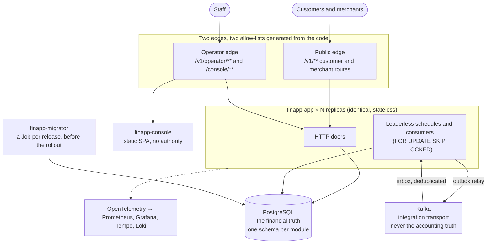

#### Modules

The modules are grouped by area below. The build enforces exactly which edges each module may have
(`ModuleBoundaryRulesTest`), and fails on any dependency that crosses a boundary it may not cross.

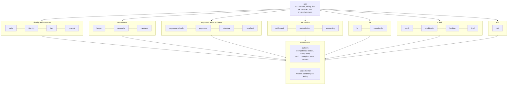

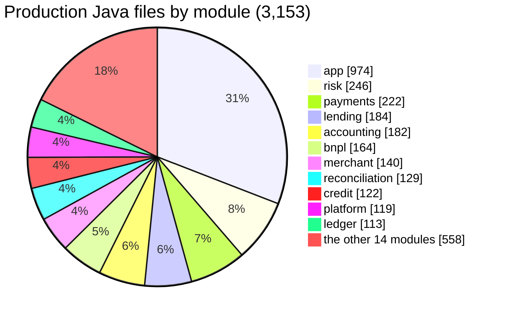

| Module | Owns | Main / test files | Migrations |
|---|---|---|---|
| `sharedkernel` | `Money` (integer minor units, explicit currency and scale), identifiers, correlation value types; no Spring | 25 / 14 | - |
| `platform` | Idempotency, the transactional outbox and inbox, audit, correlation, authentication and authorisation interceptors, the error contract | 119 / 80 | 17 |
| `party` | Parties and customers | 18 / 4 | 6 |
| `identity` | Identities, credentials (Argon2), server-side sessions, MFA, roles and permissions, segregation of duties | 87 / 27 | 30 |
| `kyc` | KYC/KYB cases, documents and evidence, screening, the review queue | 83 / 32 | 16 |
| `consent` | Versioned consent texts and the append-only consent history | 13 / 3 | 3 |
| `ledger` | Ledger accounts, the double-entry journal, balances, holds, reversals, adjustments | 113 / 41 | 39 |
| `accounts` | Customer accounts and wallets, restrictions | 29 / 5 | 3 |
| `transfers` | Internal transfers, beneficiaries, reversals | 40 / 8 | 5 |
| `paymentmethods` | Tokenised instruments: the PCI boundary | 17 / 7 | 3 |
| `payments` | Payment intents and attempts, provider adapters, rails, refunds, voids, webhooks, disputes | 222 / 45 | 42 |
| `checkout` | Checkout sessions and orders | 21 / 5 | 5 |
| `merchant` | Merchants, scoped API keys, fee schedules, payables and payouts | 140 / 36 | 22 |
| `settlement` | External settlement evidence and its recognition | 61 / 43 | 22 |
| `reconciliation` | Matching, breaks, suspense and investigation | 129 / 63 | 27 |
| `fx` | Rates, quotes, rate locks, trades, pricing policy, cover | 81 / 25 | 14 |
| `crossborder` | Corridors and cross-border payments | 47 / 10 | 8 |
| `credit` | Credit profiles, bureau adapters, policy and scorecard versions, decisions, review cases | 122 / 43 | 26 |
| `lending` | Loan applications, offers, disbursement, schedules, accrual, repayment, delinquency, capital | 184 / 59 | 36 |
| `creditmath` | The pure, deterministic credit arithmetic lending and BNPL share | 24 / 11 | - |
| `bnpl` | Pay-in-N agreements, merchant financing, instalments, refunds, disputes | 164 / 92 | 23 |
| `risk` | Signals, rules, decisions, cases, AML monitoring | 246 / 117 | 22 |
| `accounting` | GL mapping, accounting periods, the close, statements and regulatory reports | 182 / 73 | 19 |
| `migrator` | The Flyway runner shipped as the `finapp-migrator` image | 12 / 10 | - |
| `app` | The Spring Boot application: HTTP doors, wiring, the API contract and the architecture rules | 974 / 1,107 | - |

Ownership and the reasons for it: [`MODULE_ARCHITECTURE.md`](docs/architecture/MODULE_ARCHITECTURE.md),
[`BOUNDED_CONTEXTS.md`](docs/architecture/BOUNDED_CONTEXTS.md).

#### Stack

| Area | In use |
|---|---|
| Language and build | Java 21 (pinned toolchain), Gradle wrapper with dependency locking and SHA-256 verification, Lombok under a restricted `lombok.config` |
| Application | Spring Boot 4.1 (web, actuator, JDBC). **No Spring Security**: the platform's own interceptors over server-side sessions and scoped merchant keys, with `spring-security-crypto` for Argon2 only. **No ORM**: explicit JDBC (ADR-0033) |
| Data | PostgreSQL 18 through explicit JDBC; Flyway 13 per-module migrations, expand-only; four database roles, least privilege |
| Messaging | Kafka 4.3 (KRaft) behind the transactional outbox and an inbox; **never** the accounting truth |
| Not used by the application | Redis (local compose only); object storage (evidence lives in PostgreSQL, ADR-0036) |
| Observability | OpenTelemetry over OTLP to one collector; Prometheus, Alertmanager, Grafana; Tempo and Loki; ECS JSON logs |
| Testing | JUnit 6, AssertJ, Testcontainers, WireMock, ArchUnit; k6 and Toxiproxy for load and faults |
| Delivery | Distroless non-root images built twice and compared, SBOMs, signing and admission, Kubernetes manifests, Argo CD promotion by digest, Terraform with mock providers |
| API | REST under `/v1`, OpenAPI generated from the running app; signed, idempotent webhooks |

#### Two surfaces

| | Public surface | Operator surface |
|---|---|---|
| **Who** | Customers (`/v1/me/**`, transfers, payments, KYC, …) and merchants (scoped API keys) | Staff, through the Operator Console (`finapp-admin-panel`, a React/TypeScript SPA) |
| **Edge** | The public edge | A separate operator edge, TLS, its own ingress |
| **Authority** | The customer's session or the merchant's key; ownership checked at every door | A permission per route; a `MULTI_FACTOR` session on every act and on the most sensitive reads (each route's `x-assurance` says which) |
| **Money acts** | Idempotent, keyed per principal | **Four eyes**: one person proposes, a different person approves |
| **Personal data** | The customer's own | Every read of a customer's data recorded before it is served |
| **Lists** | Bounded | Keyset-paged collections, `{ items, nextCursor }` |

The customer-facing web application, **finapp-front-end**, is designed in its own repository and planned as Phase 18.

### 1.4 How money moves: the rules made visible

#### Every monetary change is explainable, end to end

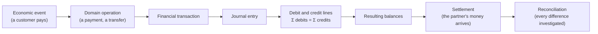

A balance is never `balance = balance + amount`. It is the sum of the journal lines that make it, so it can always be
explained line by line. A €100 transfer from customer A to customer B is one balanced entry:

| Journal line | Account | Debit | Credit |
|---|---|---:|---:|
| 1 | Customer A's wallet (a liability of the platform) | €100.00 | |
| 2 | Customer B's wallet (a liability of the platform) | | €100.00 |
| | **Total, which must be equal** | **€100.00** | **€100.00** |

A mistake is never edited away. It is reversed by a new, equal and opposite entry, and the application's database role
**lacks the privilege** to update or delete the journal, so the rule holds even against a bug.

#### A retried request moves money once (idempotency)

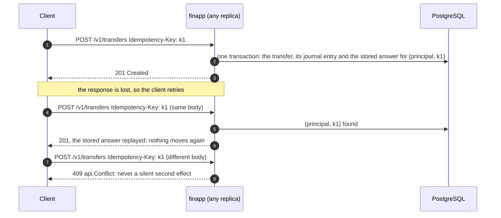

#### An operator's money act takes two people (four eyes)

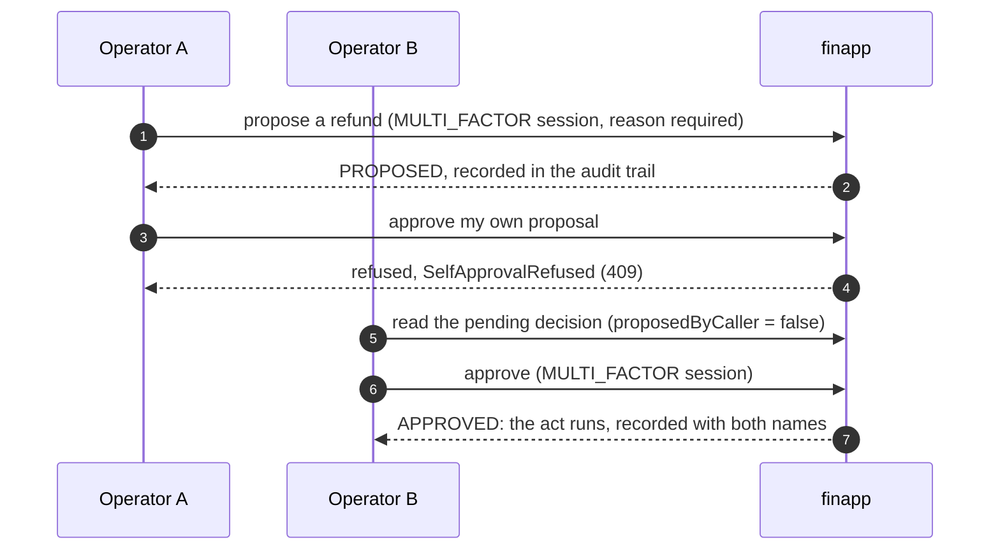

#### An event is published only if its transaction committed (outbox and inbox)

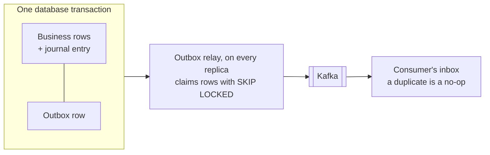

#### The rules, in short

The binding rules are in [`CLAUDE.md`](CLAUDE.md) and the invariant catalogue:

1. **No floating point for money, ever.** `Money` is an integer of minor units with an explicit currency and scale. An
   architecture rule fails the build on a `double` or `float` near money.
2. **Every journal entry balances**, per currency, and the trial balance is continuously asserted at zero.
3. **History is immutable.** Corrections are reversals, adjustments or compensating entries.
4. **Every money-moving operation has an explicit state machine**, and an outcome nobody knows yet is a modelled
   `UNKNOWN`, never a guess.
5. **Critical commands are idempotent**, and duplicate events, webhooks and requests are harmless.
6. **Kafka, caches and projections are not truth.** The outbox publishes what PostgreSQL committed.
7. **Reconciliation is a first-class capability.** External evidence is kept and matched, and every break investigated.
8. **Everything privileged is audited** with actor, time, operation, target, reason, correlation and outcome.
9. **Correct under ten instances.** Every critical path is argued, and where possible tested, under concurrent replicas.

#### How the rules are held

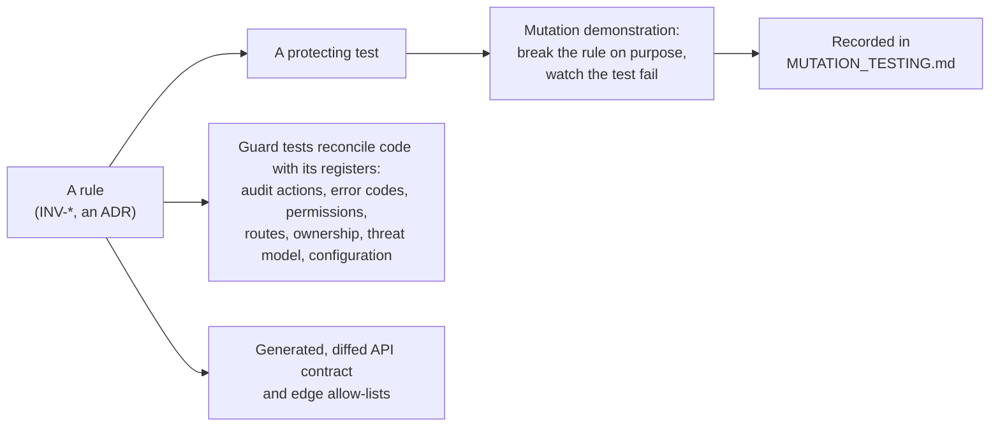

The demonstrations recent Phase 17 tasks still owe are recorded as owed in
[`MUTATION_TESTING.md`](docs/project/MUTATION_TESTING.md) and `CURRENT_STATE.md`.

### 1.5 Repository layout

```
app/, ledger/, payments/, ...   the Gradle modules (1.3)
build-logic/                    convention plugins (an included build)
docs/adr/                       architecture decision records
docs/api/                       the generated OpenAPI contract
docs/architecture/              architecture, security, data, operations, runbook, threat model
docs/domain/                    invariants and glossary
docs/product/                   vision, capability map, roadmap
docs/project/                   current state, backlog, phase plans, reviews, history, proposals
deploy/                         Kubernetes manifests, overlays and the edge's route lists
infra/                          compose config, Grafana and Prometheus, Terraform, scripts, scanner pins
compose.yaml                    the local stack
```

### 1.6 Getting started

#### Prerequisites

| You need | Why | Check with |
|---|---|---|
| **Git** | Clone the repository | `git --version` |
| **Docker** with Compose v2 | PostgreSQL, Kafka and the observability stack locally; Testcontainers for the database tier | `docker compose version` |
| A **JDK**, any recent version | Only to start Gradle | `java -version` |

You do **not** need to install Java 21, Gradle, PostgreSQL or Kafka. The wrapper is checksum-verified, and Gradle
provisions the pinned Java 21 toolchain whatever `JAVA_HOME` points at (`./gradlew toolchainInfo` reports both). In
IntelliJ IDEA, enable annotation processing for Lombok (ADR-0055).

#### Build and test

```bash
./gradlew build
```

`build` compiles every module and runs every **hermetic** test (unit, architecture and slice), green with nothing
running. Tests that need real infrastructure are separate tasks, so an absent database shows up as a task that did not
run, never as a test that silently skipped.

```
            ▲  slower, fewer, more real
            │   kafkaTest                   a real Kafka broker and the database
            │   ownContainerDatabaseTest    suites that need a PostgreSQL of their own
            │   databaseTest                a real PostgreSQL, started by Testcontainers
            │   sliceTest                   a Spring application context        ┐
            │   architectureTest            the compiled classes of every module ├ ./gradlew build
            │   unitTest                    nothing beyond the JVM              ┘
            ▼  faster, many, hermetic
```

Narrow runs: `./gradlew :ledger:unitTest`, or `./gradlew :app:architectureTest --tests '*ModuleBoundaryRulesTest*'`.
Conventions: [`docs/project/TESTING.md`](docs/project/TESTING.md).

#### The local stack (§3)

```bash
docker compose up -d --wait
```

`--wait` returns only when every container is healthy. Everything binds to `127.0.0.1`.

| Service | Address | Role |
|---|---|---|
| PostgreSQL 18.6 | `localhost:5432` | The transactional source of truth |
| Kafka 4.3.1 (KRaft) | `localhost:29092` | Event transport |
| Redis 8.10.1 | `localhost:6379` | Local only; no code uses it |
| Prometheus, Alertmanager, Grafana | Grafana at <http://localhost:3000/d/finapp-platform> | Metrics, alerts, the dashboard (provisioned from `infra/`) |
| OpenTelemetry Collector, Tempo, Loki | local | Traces and logs |

The local credentials are deliberately throwaway (`finapp` / `local-development-only-not-a-secret`), and the application
**refuses to start** if that default is aimed at anything but loopback (ADR-0020).

**Database roles.** `infra/postgres/initdb/00-roles.sql` provisions four roles on the volume's first initialisation:

| Role | Used by | Holds |
|---|---|---|
| `finapp` | The container's bootstrap | Superuser; nothing connects as it but one test fixture |
| `finapp_migrator` | Flyway | DDL, not a superuser |
| `finapp_app` | The application | Per-table DML, granted by each migration; no DDL |
| `finapp_reporting` | Report generation's own pool | `SELECT` on what reports read |

Several invariants are enforced by the application role *lacking* a privilege. If your volume predates a role, re-apply
the idempotent script, or reset with `docker compose down -v && docker compose up -d --wait`. In Git Bash, prefix with
`MSYS_NO_PATHCONV=1`:

```bash
MSYS_NO_PATHCONV=1 docker compose exec -T postgres psql -U finapp -d finapp -f /docker-entrypoint-initdb.d/00-roles.sql
```

#### Migrations

Migrations never run at application start-up (ADR-0011). Apply them explicitly:

```bash
./gradlew flywayMigrate
```

`flywayInfo` shows what is applied, and `flywayValidate` catches an edited migration. Migrations are expand-only. A
deployed environment runs the `finapp-migrator` image as a Job instead
([`DATA_MIGRATIONS.md`](docs/architecture/DATA_MIGRATIONS.md)).

#### Running the application

With the stack up and migrations applied, run `./gradlew :app:bootRun`, or run the image (1.8). It connects as
`finapp_app` (`FINAPP_DB_URL`, `FINAPP_DB_APP_USER`, `FINAPP_DB_APP_PASSWORD`). There are no Spring profiles:
environments differ by values only, and every property is in
[`CONFIGURATION_REGISTER.md`](docs/architecture/CONFIGURATION_REGISTER.md).

- **API port 8080.** Every route is under `/v1`.
- **Management port 8081**, loopback only: `/actuator/health/liveness`, `/actuator/health/readiness` (503 while
  PostgreSQL is unreachable; liveness deliberately ignores the database), `/actuator/info` and `/actuator/prometheus`.

#### The first administrator (§5e)

The first administrator cannot be created through the API: `ROLE_ASSIGN` is the administrator's own permission. That is
deliberate, so there is neither a bootstrap endpoint nor a seeded row in every environment. Register an identity
normally, enrol a second factor (`POST /v1/me/mfa`, then `/v1/me/mfa/confirmation`), then grant the role out of band:

```bash
docker compose exec postgres psql -U finapp_migrator -d finapp -c "INSERT INTO identity.role_assignment (id, identity_id, role_name, assigned_by, assigned_at) SELECT gen_random_uuid(), i.id, 'ADMINISTRATOR', i.id, now() FROM identity.identity i WHERE i.login_identifier = 'REPLACE_ME'"
```

That one grant has no other actor in the audit trail, which is recorded rather than hidden. Every later grant names two
parties, and an administrator's revocation or suspension refuses to take the last administrator. The same out-of-band
write is the last-resort way back if risk's automated suspension ever leaves none (`OPERATIONS_RUNBOOK.md` §11.12).

### 1.7 The API contract

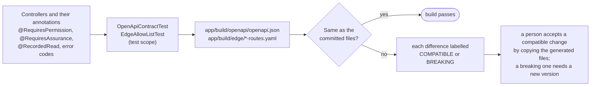

[`docs/api/openapi.json`](docs/api/openapi.json) is generated from the running application; nothing about OpenAPI ships,
so no deployed instance serves `/v3/api-docs`. A breaking change is never published under `/v1` (ADR-0015). Besides the
shapes, every operation states its `x-permission`, `x-assurance` and `x-recorded-read`, derived from its annotations. To
accept an intended, compatible change:

```bash
cp app/build/openapi/openapi.json docs/api/openapi.json
cp app/build/edge/operator-routes.yaml app/build/edge/public-routes.yaml deploy/edge/base/
```

Conventions for client authors (errors, correlation, idempotency, pagination, pending decisions, deprecation) are in
[`API_CONVENTIONS.md`](docs/architecture/API_CONVENTIONS.md). Events, in
[`EVENT_ARCHITECTURE.md`](docs/architecture/EVENT_ARCHITECTURE.md), each carry an event id, type, aggregate id, versions,
timestamp, producer, correlation and causation.

### 1.8 Images, CI and delivery

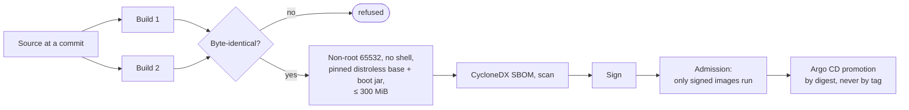

#### Building the images (§5f, §5g)

```bash
./infra/scripts/image-build.sh
```

It builds `finapp-app` twice from source and refuses the image unless both builds are byte-identical, checks it as the
diagram shows, tags it `finapp-app:<commit>` and pushes nothing.

- `./infra/scripts/image-readiness.sh` runs the image against the local stack (`docker compose up -d postgres kafka --wait`
  and `./gradlew flywayMigrate` first), read-only and with every capability dropped.
- `./infra/scripts/image-scan.sh` scans every `finapp-*` image and writes one CycloneDX SBOM each.
- The migrator image has `./infra/scripts/migrator-image-build.sh` and `./infra/scripts/migrator-verify.sh`; the latter
  compares the image's schema with `flywayMigrate`'s on throwaway databases and races ten concurrent runs.
- **Updating a base image**: the two `FROM` lines are pinned `tag@sha256:digest`. Re-resolve a digest with
  `docker buildx imagetools inspect <image>:<tag>`.

#### What CI checks (§6)

[`.github/workflows/ci.yml`](.github/workflows/ci.yml) runs independent jobs, so a failure names its own gate:

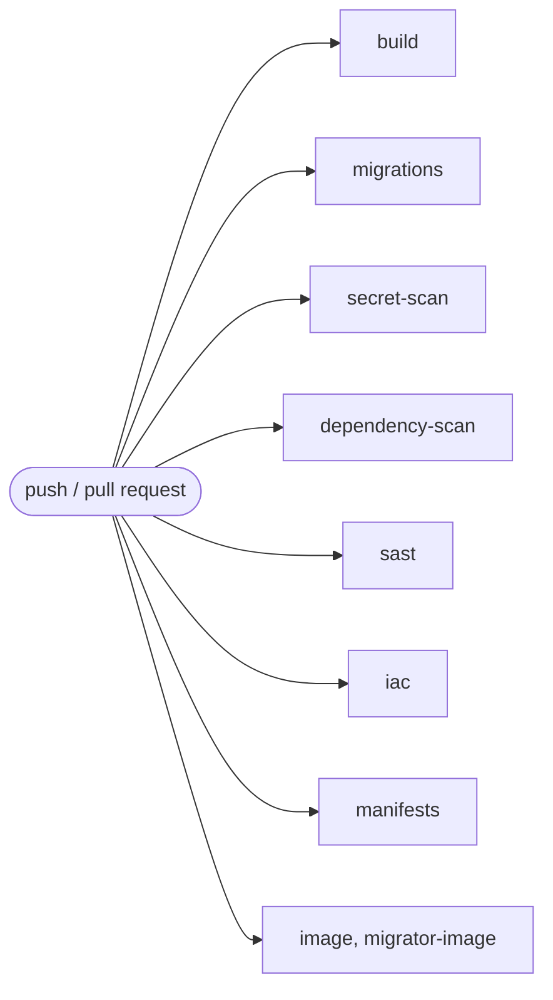

| Job | Gate |
|---|---|
| `build` | Compilation, hermetic tests, boundary rules, version drift, wrapper checksum, no credential literal in config |
| `migrations` | Migrations apply to an empty database, re-apply idempotently, still match the repository |
| `secret-scan` | No secret anywhere in git **history** (`./infra/scripts/secret-scan.sh`) |
| `dependency-scan` | No HIGH or CRITICAL vulnerability in the resolved dependency set |
| `sast` | Semgrep over production source, findings fixed or baselined with a reason |
| `iac` | Terraform `fmt`, `tflint`, `trivy config`, `validate` and `terraform test` with mock providers |
| `manifests` | Every overlay renders, passes `kubeconform -strict` and every policy; the edge's route lists through the real proxy |
| `image`, `migrator-image` | The two images: reproducible, non-root, minimal, scanned, ready |

Every gate is a pinned script that also runs on a developer's machine (`infra/scripts/`). Rehearsals run on demand cover
signing and admission, promotion by digest, restore, migration failure, telemetry scrubbing and a full `kind` rehearsal
(`OPERATIONS_RUNBOOK.md` §11).

#### Changing a dependency (§7a)

Every artefact is checksum-verified and version-locked (`gradle/verification-metadata.xml` and a `gradle.lockfile` per
project, ADR-0025). Change the version in `gradle/libs.versions.toml`, then regenerate **both records in one
invocation**, because each control blocks the other's regeneration, and do it **on a cold cache**: a warm
`GRADLE_USER_HOME` records less than a fresh machine needs.

```bash
GRADLE_USER_HOME=$(mktemp -d) ./gradlew --write-locks --write-verification-metadata sha256 build databaseTest
```

- `build-logic` is locked separately: `cd build-logic && ../gradlew --write-locks build`.
- **Read both diffs.** The lockfile names every version that moved; the metadata names every artefact now trusted.
- Gradle never prunes. Delete a removed dependency's entries by hand in the same change.
- The checksums are trust-on-first-use. Treat a verification failure as a compromise until the artefact is checked
  against its publisher's own checksum.

#### Keeping the pins fresh (§7b)

Everything is pinned, so everything can rot (ADR-0026). Dependabot proposes the GitHub Actions, libraries, the two base
images and the Terraform providers weekly; a library PR fails its build until the §7a regeneration is run.
`./infra/scripts/check-pinned-images.sh` checks the scanner and tool images (`infra/scanner-pins.sh`) and the base images,
and tells a moved tag, which needs explaining first, from a newer release, which is ordinary rot.
`verifyInfrastructureVersions` fails the build when `compose.yaml` drifts from the version catalog.

### 1.9 Troubleshooting

| Symptom | Cause and fix |
|---|---|
| `PKIX path building failed` | Something re-signs HTTPS (a corporate proxy, antivirus scanning). On Windows add `org.gradle.jvmargs=-Djavax.net.ssl.trustStoreType=Windows-ROOT -Xmx2g -XX:MaxMetaspaceSize=512m` to `~/.gradle/gradle.properties`, and export `GRADLE_OPTS="-Djavax.net.ssl.trustStoreType=Windows-ROOT"` for the first wrapper download |
| `clean` cannot delete a directory (Windows) | An orphaned Gradle daemon holds a file, or a shell's working directory is inside the build directory. Stop *your own* daemons; on a shared machine kill only the orphan's PID |
| An edited file seems ignored by an incremental build | File-system watching can miss edits made while a build runs. Re-run with `--no-watch-fs`, and `--rerun` on the compile task |
| `docker compose exec` rewrites paths (Git Bash) | Prefix with `MSYS_NO_PATHCONV=1`, or use PowerShell |
| `password authentication failed for user "finapp_migrator"` / `role "finapp_reporting" does not exist` | The role script never ran on your volume (1.6) |

### 1.10 Where to read next

| Question | Document |
|---|---|
| Where is the project right now? | [`docs/project/CURRENT_STATE.md`](docs/project/CURRENT_STATE.md) |
| What are the rules for changing this codebase? | [`CLAUDE.md`](CLAUDE.md), [`EXECUTION_PROTOCOL.md`](docs/project/EXECUTION_PROTOCOL.md) |
| When is work done? | [`DEFINITION_OF_DONE.md`](docs/project/DEFINITION_OF_DONE.md) |
| What must never be violated? | [`FINANCIAL_INVARIANTS.md`](docs/domain/FINANCIAL_INVARIANTS.md) |
| What does a term mean? | [`GLOSSARY.md`](docs/domain/GLOSSARY.md) |
| Why was something decided this way? | [`docs/adr/`](docs/adr/README.md), [`DECISIONS.md`](docs/project/DECISIONS.md) |
| How is it secured, and against what? | [`SECURITY_ARCHITECTURE.md`](docs/architecture/SECURITY_ARCHITECTURE.md), [`THREAT_MODEL.md`](docs/architecture/THREAT_MODEL.md) |
| How is it run and recovered? | [`OPERATIONS_RUNBOOK.md`](docs/architecture/OPERATIONS_RUNBOOK.md), [`SLOS.md`](docs/architecture/SLOS.md), [`PRODUCTION_READINESS.md`](docs/architecture/PRODUCTION_READINESS.md) |
| What is planned? | [`ROADMAP.md`](docs/product/ROADMAP.md), [`BACKLOG.md`](docs/project/BACKLOG.md) |
| What was proposed but not approved? | [`docs/project/proposals/`](docs/project/proposals/README.md) |

---

## 2. For non-technical readers

### 2.1 What finapp is

finapp is **the engine room of a digital financial company**: what a bank, a payments company or a lender runs behind
its app. It is built as a reference, to show *how* such a system should be engineered when real money is at stake. It
is not tied to one country's rules; country-specific requirements plug in at clearly marked places.

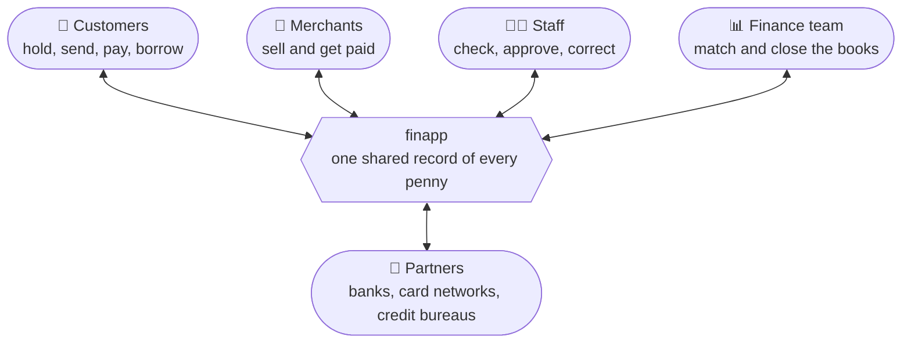

### 2.2 What it can do today

| For… | What they can do |
|---|---|
| 👤 **Customers** | Open an account and prove who they are ("KYC"); give or withdraw consent; hold money in wallets in several currencies; send money; pay by card, instant bank transfer or wallet; exchange currencies at a locked rate and send money abroad; apply for credit and loans and get an explained decision; buy now and pay later in instalments |
| 🏪 **Merchants** | Join after a business check ("KYB"); take payments at checkout; refund; handle disputes and chargebacks; receive payouts net of agreed, versioned fees |
| 🧑‍💼 **Staff** (the Operator Console) | Look up customers, merchants, accounts, payments and loans; review identity checks; investigate fraud and money-laundering alerts; approve or reject sensitive actions; see only what their role allows |
| 📊 **Finance team** | Match the company's records against what banks and card networks report; investigate every difference; keep a general ledger; close each month with a second person's approval; produce financial and regulatory reports |

### 2.3 The promises it is built on

In most software a small bug is an inconvenience. In financial software it can create or lose money that does not
exist. finapp is built around six promises:

| | Promise | In everyday terms |
|---|---|---|
| ⚖️ | **Money is never created or lost by accident** | Every movement is written twice, as "out of here" and "into there", and the two sides must always match, like an accountant's double-entry book |
| 📜 | **Nothing is ever erased** | A mistake is fixed by a new, visible correction, never by rewriting history. Anyone can see what happened and when |
| 🔁 | **Pressing "pay" twice pays once** | Networks fail and people retry. The system recognises a repeated request and never acts twice |
| ❓ | **"Unknown" is an honest answer** | If a partner's answer is unclear, the system never guesses that a payment worked or failed. It finds out, and checks |
| 👀 | **Everything important leaves a trail** | Who did it, when, to what, why, and what happened |
| 🖥️🖥️🖥️ | **It works on many machines at once** | Built to run on several computers together without two of them doing the same thing twice |

#### What "written twice" looks like

When Anna sends Ben €100, finapp writes one entry with two sides. If the two sides ever disagreed, the system would
refuse to record it.

```
   Anna's wallet                 Ben's wallet
 ┌───────────────┐             ┌───────────────┐
 │  − €100.00    │ ──────────▶ │  + €100.00    │
 └───────────────┘             └───────────────┘
        out            =             in            ✔ balanced: no money created, none lost
```

#### What "two people" looks like

Any action by staff that moves money, such as a refund, a payout or a correction, needs two different people.

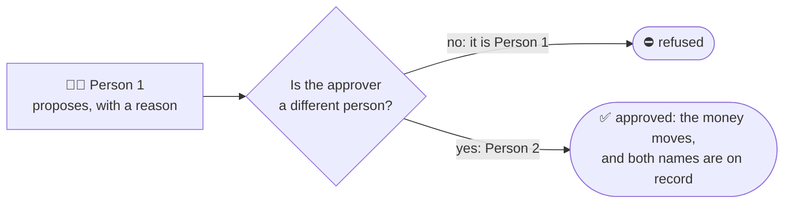

#### What "pressing pay twice" looks like

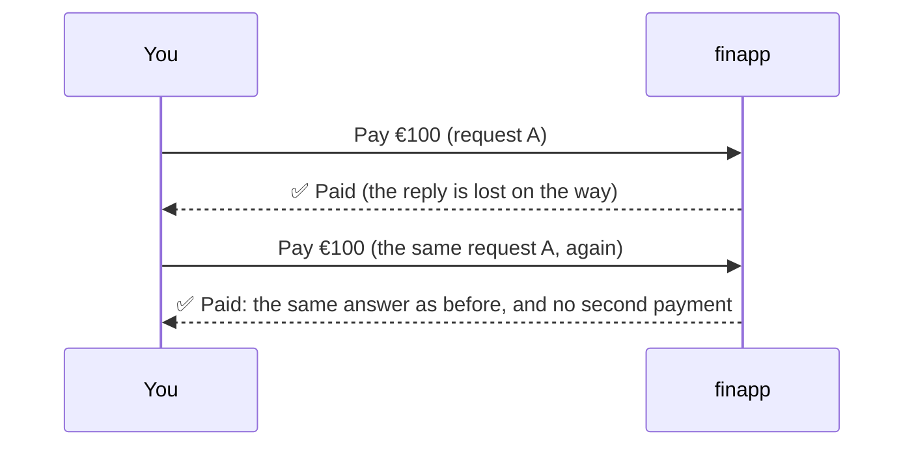

These promises are written down as **171 rules**. Automated checks stop the work if one is broken, and the checks are
themselves tested by deliberately breaking a rule to prove they catch it. The few recent checks not yet tested this way
are recorded as owed.

### 2.4 How the work is run

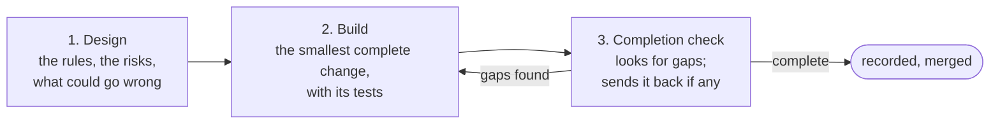

The project is delivered in **phases**, each with a written plan and a clear definition of "done". A phase is finished
when a formal review says so, not when its tasks are, and several reviews have sent a phase back for more work. Every
significant decision is written down with its reasons: **150** so far.

The project owner is building finapp deliberately to develop deep expertise in financial systems and system design, so
the documentation is a large part of the result: why each part exists, and what would go wrong without it.

### 2.5 Where it stands

```
All phases        ████████████████████████████████████████░░  17 of 18 complete
Staff console     ███████████████████████████████████████░░░  50 of 52 items done
```

| | |
|---|---|
| ✅ **Done** | Foundations, identity, verification, the ledger, transfers, payments, merchants, cards and instant payments, settlement, FX and cross-border, credit, lending, buy-now-pay-later, risk and anti-money-laundering, accounting, production readiness, scale and disaster recovery |
| 🟡 **Nearly done** | The backend for the staff console: the end-to-end test battery and the formal exit review remain |
| ⏭️ **Next** | A customer-facing web application, planned in its own project |

> **What it is not, yet**
> - It has **never run in a real environment** and moves no real money. Its connections to banks, card networks and
>   credit bureaus are simulated.
> - It is **not licensed or certified** for any country. The core is deliberately jurisdiction-neutral.
> - Some recent work was merged with lighter testing, at the owner's choice to finish faster. The remaining tests are
>   recorded as owed, not forgotten.

### 2.6 A few terms

| Term | Meaning |
|---|---|
| **Ledger** | The book where every movement of money is recorded: the final word on who owns what |
| **Double entry** | Every movement recorded as money out of one place and into another, always in balance |
| **KYC / KYB** | "Know your customer / business": checking who a person or company really is |
| **AML** | Anti-money-laundering: spotting and stopping suspicious flows of money |
| **Reconciliation** | Comparing the company's records with its partners' records, and explaining every difference |
| **Settlement** | When money between companies actually changes hands, often days after a payment |
| **Four eyes** | Two different people must agree before a sensitive action happens |
| **BNPL** | Buy now, pay later: paying for a purchase in instalments |
| **FX** | Foreign exchange: converting one currency into another |
| **Idempotency** | Doing the same request twice has the effect of doing it once |
